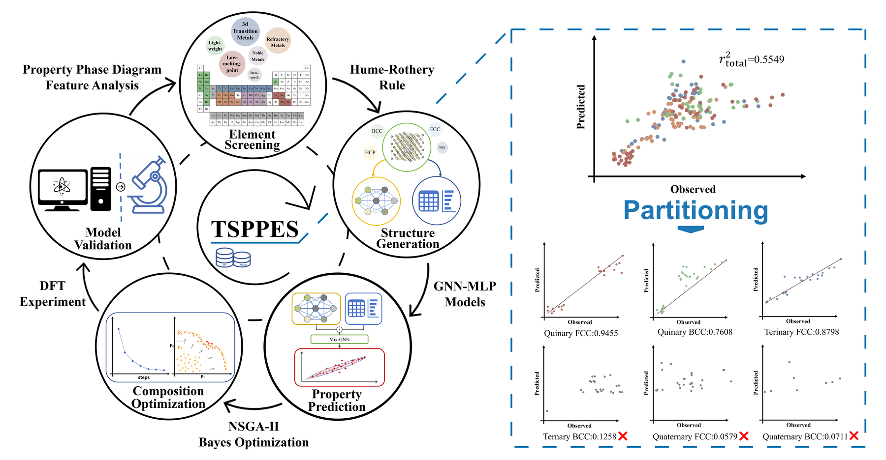

# HEA-LTC-BM

<p align="center">
  
</p>

Machine-learning-guided screening of high-entropy alloys (HEAs) with high
bulk modulus (B) and lattice thermal conductivity (κ_l), combining a
Mix-GNN property-prediction model pre-trained on universal materials
databases (Materials Project and AFLOW) with target-space partitioning,
pre-testing and multi-objective optimization (NSGA-II).

This repository has two branches:

- `main` — the complete, packaged project (this branch). The code under
  `code/` is organized as a five-stage data chain, and model training and
  composition optimization can be run directly from the command line
  (`code/train.py`, `code/optimize.py`).
- `manual` — the original author-written project code (model architecture,
  training, inference, feature engineering), preserved as-is.

AI-assisted parts: the scripts in `plus_analysis/` (data visualization and
validation figures) and the packaging files of this branch were produced
with the help of Kimi (Moonshot AI); every such script declares the
human/AI task division in its header.

## The five-stage data chain (`code/`)

1. **Data extraction — `code/data_processing/`**
   Feature engineering and dataset assembly: CGCNN crystal-graph features
   (`cgcnn_data_processing.py`), composition/structure/element-property
   descriptors (`mlp_data_processing.py`), min-max normalization
   (`features_normalization*.py`), and merging both parts
   (`data_combine.py`). `dataset_construction/` holds the dataset-building
   utilities; `materials_id_in_data_sets/materials_ids_in_datasets.xls`
   lists the MP and AFLOW identifiers of all training-database entries.
   `calculate_ltc_qha.py` post-processes quasi-harmonic (QHA) lattice
   thermal conductivity calculations.
2. **Model training — `code/training/`**
   The Mix-GNN model (CGCNN branch + MLP descriptor branch, element-wise
   product fusion; architecture in `code/models/mixmodel.py`).
   `mix_model_regress_loop.py` is the final training loop that produced the
   released models; `training.py` is the Optuna hyperparameter search;
   `variants/` holds ablation variants (CGCNN-only, MLP-only, ...).
   Run from the command line:
   ```bash
   python code/train.py --property bulk_modulus --data-dir ./data_set/bulk_modulus \
       --save-root ./runs/bm --max-models 5
   ```
   The data directory must contain `features_normalized_<property>_log.csv`
   and `cgcnn-voronoi-<property>-HEA.pt` (built by stage 1; also available
   in the Zenodo data package).
3. **Optimization — `code/optimization/`**
   `nsga_2_for_core_loss.py` — NSGA-II multi-objective optimization of B
   and κ_l; `nsga_2_for_core_loss_poscar_output_batch_processing.py` — the
   batch variant that exports every candidate's POSCAR (used for the
   20 element subgroups in the paper); `bayes_optimization.py` — TPE
   single-objective optimization; `nsga_structure_transfer.py` — log
   utilities. Run from the command line:
   ```bash
   # multi-objective (B + kappa_l), quinary FCC+BCC search
   python code/optimize.py --method nsga2 --n-components 5 --frameworks fcc bcc \
       --elements Ti V Cr Mn Fe Co Ni Cu Nb Mo Al Y \
       --generations 500 --popnum 100 --out-dir ./opt_run

   # single-objective (TPE)
   python code/optimize.py --method tpe --property bulk_modulus \
       --n-components 4 --frameworks fcc --trials 2000 --out-dir ./tpe_run
   ```
   Both use the pre-trained models in `pre_trained_models/` by default and
   build alloy structures from the pure-metal templates in
   `initial_structure/` (the species are fully substituted and the lattice
   constants recomputed, so the choice of template metal is immaterial).
   The optimization objectives and the values in `pareto_front.csv` are the
   de-normalized raw model outputs — the same convention as the NSGA-II
   POSCAR filename values, i.e. BEFORE the per-subspace linear calibration
   (TSPPES value mapping). They are monotonic within the validated
   subspaces, so the optimization ranking is unaffected; apply the subspace
   mapping (see the manuscript and `plus_analysis/`) to obtain physical
   units (GPa, W·m⁻¹·K⁻¹).
4. **Solid-solution screening — `code/screening/`**
   Empirical screening criteria: δ (`delta_filtering.py`), VEC
   (`vec_filtering.py`, `modify_ratio_for_vec.py`) and mixing enthalpy
   ΔH_mix (`delta_H/`).
5. **Visualization — `code/visualization/`**
   The figure scripts and assets of the manuscript (`painting_figures/`),
   kept as archival reference code.

Additional folders:

- `pre_trained_models/` — released Mix-GNN weights for B and κ_l with
  feature normalization statistics (`normalization.pt`) and the serialized
  test sets (`test_loader.pt`; the full datasets are listed in
  `materials_ids_in_datasets.xls`, so the training split can be recovered
  as the complement of the test split).
- `crystal_framework/` — primitive cells of pure metals (fcc/bcc/hcp).
- `initial_structure/` — the three supercell templates used by the
  optimization scripts (`POSCAR_Cu_fcc`, `POSCAR_W_bcc`, `POSCAR_Zr_hcp`).
- `code/inference/` — batch property prediction for alloy POSCAR folders
  (`alloy_test_*.py`, `pure_metal_test.py`).
- `plus_analysis/` — AI-assisted validation and visualization scripts
  (six-family benchmark, element marginal distributions, efficiency
  comparison, four literature-system validations). They keep their
  original relative-path logic and expect the original project layout; the
  data they read are in the Zenodo data package. A few scripts reference
  Chinese-named data files (e.g. 组分和相.csv, 参考文献.xlsx); those names
  are kept unchanged so they still match the actual files.

## Data availability

Source data for Tables 4-7 and all data-generated figures, including the
experimental and literature-validation data, are available on Zenodo at
https://doi.org/10.5281/zenodo.23938398. The MP and AFLOW IDs used for model
training/validation and alloy structures in pre-testing datasets are provided
with the code on GitHub at https://github.com/xiezhen087/HEA-LTC-BM
(`code/materials_id_in_data_sets/materials_ids_in_datasets.xls`). Modeling and
property details for all pre-testing alloys are provided in the Supplementary
Information.

Script data paths marked with `# TODO: set your local data path` should be
pointed at the downloaded data package.

## Requirements

See `requirements.txt`. The models were trained with PyTorch 2.1 (CUDA
12.1) and PyTorch Geometric 2.4; inference and optimization also run on
CPU-only builds.

## Citation

Citation details will be added upon publication.

---

# HEA-LTC-BM（中文说明）

本项目利用机器学习筛选兼具高体积模量（B）与高晶格热导率（κ_l）的高熵合金
（HEA）：先在通用材料数据库（Materials Project 与 AFLOW）上预训练 Mix-GNN
性质预测模型，再结合目标空间分区、预测试与多目标优化（NSGA-II）进行成分筛选。

仓库包含两个分支：

- `main`——完整封装版（本分支）：`code/` 按五阶段数据链组织，模型训练与
  成分优化可直接通过命令行运行（`code/train.py`、`code/optimize.py`）。
- `manual`——作者独立完成的原始代码（模型结构、训练、推理、特征工程），
  原样保留。

AI 辅助部分：`plus_analysis/` 中的数据可视化与验证脚本，以及本分支的封装
文件由 Kimi（月之暗面）辅助完成；每个此类脚本头部都注明了人工/AI 任务分工。

## 五阶段数据链（`code/`）

1. **数据提取——`code/data_processing/`**：CGCNN 晶体图特征
   （`cgcnn_data_processing.py`）、成分/结构/元素性质描述符
   （`mlp_data_processing.py`）、归一化（`features_normalization*.py`）、
   两部分数据合并（`data_combine.py`）；`dataset_construction/` 为数据集
   构建工具；`materials_id_in_data_sets/materials_ids_in_datasets.xls` 列出
   训练数据库全部条目的 MP 与 AFLOW 编号；`calculate_ltc_qha.py` 为准谐
   （QHA）晶格热导计算的后处理。
2. **模型训练——`code/training/`**：Mix-GNN 模型（CGCNN 分支 + MLP 描述符
   分支，逐元素乘积融合；结构定义在 `code/models/mixmodel.py`）。
   `mix_model_regress_loop.py` 是产出发布模型的最终训练循环；
   `training.py` 为 Optuna 超参搜索；`variants/` 收录消融变体（仅 CGCNN、
   仅 MLP 等）。命令行运行：
   ```bash
   python code/train.py --property bulk_modulus --data-dir ./data_set/bulk_modulus \
       --save-root ./runs/bm --max-models 5
   ```
   数据目录需包含 `features_normalized_<性质>_log.csv` 与
   `cgcnn-voronoi-<性质>-HEA.pt`（由第 1 阶段生成，也见 Zenodo 数据包）。
3. **优化算法——`code/optimization/`**：`nsga_2_for_core_loss.py` 为 B 与
   κ_l 的 NSGA-II 多目标优化；`nsga_2_for_core_loss_poscar_output_batch_processing.py`
   为批量导出每个候选 POSCAR 的版本（对应论文 20 个元素子组）；
   `bayes_optimization.py` 为 TPE 单目标优化；`nsga_structure_transfer.py`
   为日志工具。命令行运行：
   ```bash
   # 多目标（B + κ_l），五元 FCC+BCC 搜索
   python code/optimize.py --method nsga2 --n-components 5 --frameworks fcc bcc \
       --elements Ti V Cr Mn Fe Co Ni Cu Nb Mo Al Y \
       --generations 500 --popnum 100 --out-dir ./opt_run

   # 单目标（TPE）
   python code/optimize.py --method tpe --property bulk_modulus \
       --n-components 4 --frameworks fcc --trials 2000 --out-dir ./tpe_run
   ```
   两者默认使用 `pre_trained_models/` 中的预训练模型，并基于
   `initial_structure/` 中的纯金属模板构建合金结构（模板中的元素会被完全
   替换、晶格常数会重新计算，因此模板金属的选择不影响结果）。优化目标值
   与 `pareto_front.csv` 中的数值为模型去归一化后的原始输出——与 NSGA-II
   的 POSCAR 文件名数值同一约定，即尚未经过分区线性校准（TSPPES 数值
   映射）。原始值在已验证子空间内单调，不影响优化排序；物理单位
   （GPa、W·m⁻¹·K⁻¹）需经子空间映射得到（见文稿及 `plus_analysis/`）。
4. **固溶筛选——`code/screening/`**：经验固溶判据：δ（`delta_filtering.py`）、
   VEC（`vec_filtering.py`、`modify_ratio_for_vec.py`）与混合焓 ΔH_mix
   （`delta_H/`）。
5. **可视化——`code/visualization/`**：论文图件脚本与资源
   （`painting_figures/`），作为存档参考代码保留。

其他目录：

- `pre_trained_models/`——B 与 κ_l 的发布模型权重、特征归一化统计量
  （`normalization.pt`）与序列化测试集（`test_loader.pt`；完整数据集见
  `materials_ids_in_datasets.xls`，训练集可由全集对测试集取补集恢复）。
- `crystal_framework/`——纯金属单胞（fcc/bcc/hcp）。
- `initial_structure/`——优化脚本使用的三个超胞模板（`POSCAR_Cu_fcc`、
  `POSCAR_W_bcc`、`POSCAR_Zr_hcp`）。
- `code/inference/`——合金 POSCAR 文件夹的批量性质预测（`alloy_test_*.py`、
  `pure_metal_test.py`）。
- `plus_analysis/`——AI 辅助的验证与可视化脚本（六族基准、元素边际分布、
  效率对比、四组文献体系验证）。这些脚本保留原始相对路径逻辑，需在原始
  项目布局下运行；其读取的数据见 Zenodo 数据包。个别脚本引用了中文命名的
  数据文件（如 组分和相.csv、参考文献.xlsx），为与实际文件对应未做改动。

## 数据可用性

表 4-7 及所有由数据生成的图件的源数据（包括实验数据与文献验证数据）均可在
Zenodo 获取：https://doi.org/10.5281/zenodo.23938398。模型训练/验证所用的
MP 与 AFLOW 条目 ID 以及预测试数据集的合金结构随代码提供于 GitHub
https://github.com/xiezhen087/HEA-LTC-BM
（`code/materials_id_in_data_sets/materials_ids_in_datasets.xls`）。所有预测试
合金的建模与性质细节见补充信息（Supplementary Information）。

脚本中带有 `# TODO: set your local data path` 标记的数据路径，请指向下载后的
数据包。

## 运行环境

见 `requirements.txt`。模型训练使用 PyTorch 2.1（CUDA 12.1）与 PyTorch
Geometric 2.4；推理与优化在 CPU 版本上也可运行。

## 引用

引用信息将在文章正式发表后补充。
